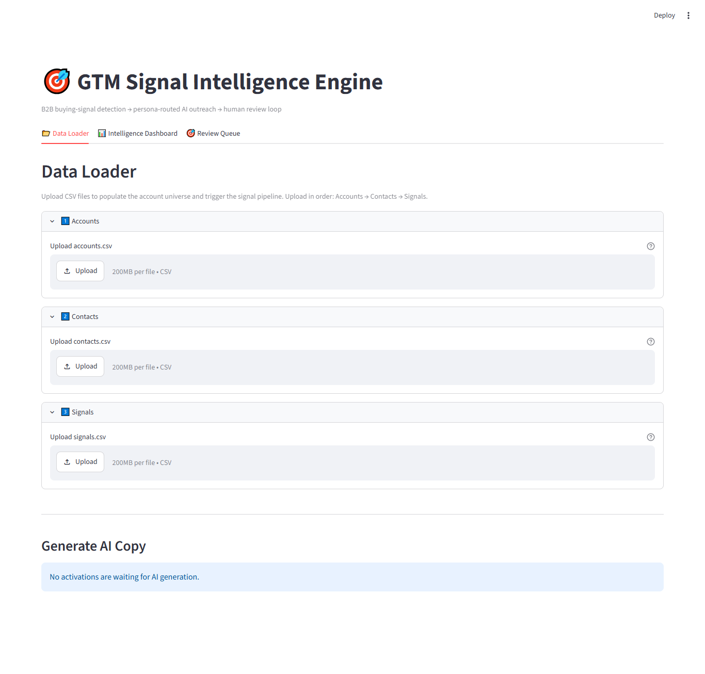

# GTM Signal Intelligence Engine

A B2B demand generation platform.


---
## Overview

This platform detects buying signals, scores them by urgency and ICP fit, 
routes them to the right buyer persona, 
and generates evidence-backed personalized outreach using Claude AI.
Includes a human-in-the-loop review workflow.

---

## GTM Signal Intelligence Engine Overview
from docs/screenshots/gtm-intelligence-engine-01-home-screen-dashboard.png

---

## Problem It Solves

B2B sales teams drown in noisy data: funding announcements, executive hires, tech installs, job postings. Most of this signal data is acted on too late, by the wrong rep, with generic messaging. The result: wasted pipeline, missed timing windows, and outreach that reads like it was bought from a list.

**The real problem isn't data — it's turning signals into action at the right time, for the right person, with the right message.**


## Core Features

- **Signal Ingestion Pipeline** — Upload CSV data for accounts, contacts, and buying signals with flexible column mapping
- **Urgency Scoring Engine** — Configurable base scores per signal type with ICP-tier multipliers (Tier 1: 1.2x through Tier 4: 0.6x)
- **Signal Decay Engine** — Automatic expiration based on signal type (90 days for funding, 14 days for webcast attendance)
- **MD5 Deduplication** — Prevents duplicate signal processing using hash of account + signal type + date
- **Persona Routing** — Maps signals to the most relevant buyer persona using a configurable routing matrix with keyword-based override for executive hire signals
- **Account Suppression** — Automatically blocks signals for customer, open opportunity, and do-not-contact accounts
- **AI Outreach Generation** — Claude Haiku generates LinkedIn notes (300 char max), email hooks, and SDR prep notes with strict evidence-grounding rules
- **LLM Response Caching** — Skips redundant API calls if a valid activation exists within a configurable TTL window (default 14 days)
- **Human-in-the-Loop Review Queue** — Streamlit UI with editable AI copy, evidence panels, and structured rejection reasons (bad timing, wrong persona, hallucination)
- **CSV Export** — Download approved activations with full context for import into sales engagement tools
- **Intelligence Dashboard** — KPIs, signal distribution charts, activation funnel visualization, and account universe table

---
## Live Demo , Features, and Bugs
[Live Demo Link ](Link Coming Soon)

[Report Bug](Link Coming Soon) · 

[Request Feature](Link Coming Soon)

---
## Tech Stack

| Layer | Technology |
|-------|-----------|
| Backend API | Python 3.11+, FastAPI, Uvicorn |
| Database | SQLite via SQLAlchemy ORM |
| Validation | Pydantic (input schemas + LLM output enforcement) |
| LLM | Anthropic Claude Haiku via tool use |
| Frontend | Streamlit (3-tab HITL interface) |
| Data Ingestion | Pandas with adapter pattern (CSV provider) |
| Configuration | YAML (scoring, decay, routing, prompts) |
| Testing | Pytest with mocked Anthropic client |


---

## Architecture

```
CSV Upload / API
       |
  [Data Adapter Layer]  ── MockCSVProvider (extensible to live APIs)
       |
  [Account Service]     ── Domain normalization, upsert, ICP classification
       |
  [Signal Pipeline]     ── Dedup → Score → Decay → Persona Route → Create Activation
       |
  [LLM Generator]       ── Claude Haiku tool use → Pydantic validation → Cache check
       |
  [Review Queue UI]     ── Streamlit HITL: approve / edit / reject → CSV export
```

Three decoupled modules:
1. **Account Intelligence Layer (The Spine)** — Identity resolution, ICP classification, suppression rules
2. **Signal Detection & Timing Engine (The Heartbeat)** — Scoring, decay, deduplication, persona routing
3. **Signal-Based Activation Generator (The Output)** — LLM generation, evidence tracking, human review


---

## Installation

```bash
# Clone the repository
git clone <repo-url>
cd "GTM Signal Intelligence Engine"

# Create and activate a virtual environment
python -m venv venv
# Windows:
venv\Scripts\activate
# macOS/Linux:
source venv/bin/activate

# Install dependencies
pip install -r requirements.txt
```

## Configuration

Copy `.env.example` to `.env` and set your Anthropic API key:

```
ANTHROPIC_API_KEY=sk-ant-your-key-here
DATABASE_URL=sqlite:///./gtm_engine.db
LLM_CACHE_TTL_DAYS=14
```

Scoring, decay, persona routing, and LLM prompts are configured in YAML — no code changes needed:
- `config/signal_config.yaml` — Base scores, ICP multipliers, decay periods, routing matrix
- `config/prompts.yaml` — System prompt and signal framing hints

## Running the Application

Start both services (requires two terminal windows):

```bash
# Terminal 1: FastAPI backend (creates database on first run)
uvicorn app.main:app --reload

# Terminal 2: Streamlit UI
streamlit run app/ui/streamlit_app.py
```


## Screenshots

See [docs/screenshots](docs/screenshots) for descriptions of what is visible in each screenshot.


## Known Limitations

- **SQLite only** — Single-writer constraint; not suitable for concurrent multi-user production use
- **CSV ingestion only** — No live API integrations (Apollo, Clearbit, Bombora) yet; adapter pattern is ready
- **No CRM sync** — Approved activations export to CSV but don't push to Salesforce/HubSpot
- **No authentication** — API and UI are unauthenticated; intended for local/demo use
- **Batch LLM calls** — Activations are generated sequentially, not in parallel
- **No GDPR/CCPA compliance** — No automatic PII expiration or data retention policies

## Future Direction

See [ROADMAP.md](ROADMAP.md) for a prioritized list.

## More Detail

| Document | Description |
|----------|-------------|
| [PROJECT_SUMMARY.md](PROJECT_SUMMARY.md) | Executive summary and architecture overview |
| [ROADMAP.md](ROADMAP.md) | Development roadmap and priorities |

## License
Copyright (c) M. Kyle Craig. 
All rights reserved.

Redistribution and use in source and binary forms, with or without modification, are NOT permitted without prior written permission from the copyright holder.

This software is provided for evaluation and review purposes only.